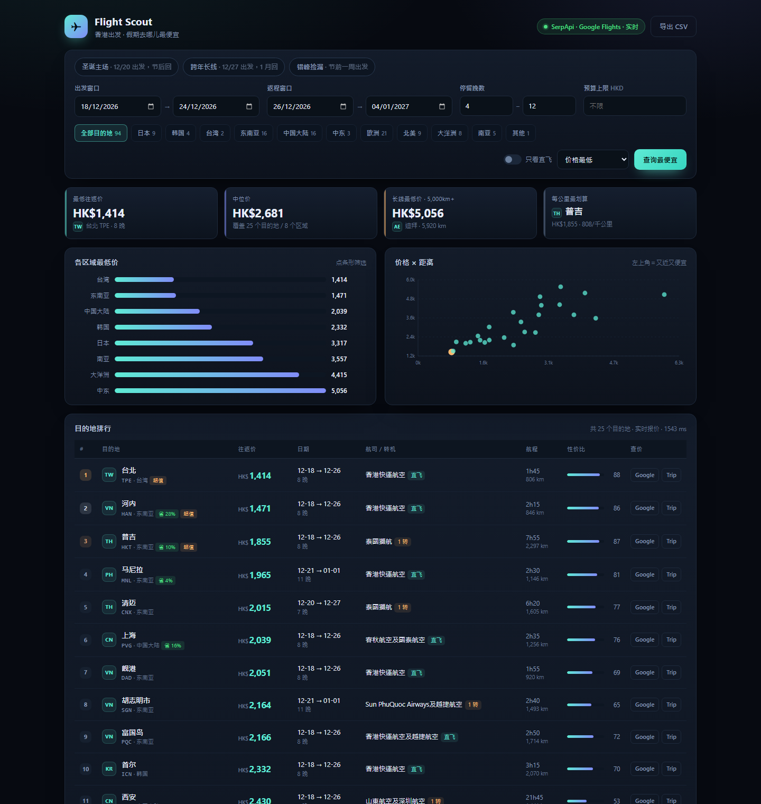

# Flight Scout · 香港出发「圣诞去哪儿最便宜」

一个本地小工具，回答一个问题：**12 月圣诞假期从香港出发，飞去哪里最便宜？**

它会把你可能想去的 90+ 个目的地全部按最低往返价排一遍，给出价格、日期、航司、转机次数、航程、性价比，并直接生成 Google Flights / Trip.com 的查价链接。



> 界面有浅色 / 深色两套主题，右上角 🌙 / ☀️ 一键切换，**默认浅色**，选择会记在浏览器里。

---

## 第一次用，只看这三步

> 完全不写代码、不敲命令。详细版见 [新手必读.md](新手必读.md)

1. **双击 `启动.cmd`** —— 会弹一个黑窗口（别关），浏览器自动打开工具
2. **随便点着玩** —— 顶部的「圣诞主场 / 跨年长线 / 错峰捡漏」、区域按钮、每行的 Google / Trip 链接都能点
3. **点右上角黄色标签** → 按弹窗里的 4 步拿到免费密钥 → 粘贴 → 点「保存并测试」→ 标签变绿，价格就是真的了

黑窗口关掉 = 工具停止。下次用再双击一次即可。

### 想在手机上用（iPhone / 安卓）

有两条路：

- **同一个 Wi-Fi**：双击 `共享给同事.cmd`，用手机打开窗口里打印的地址（电脑要开着）
- **随时随地**：部署到 GitHub Pages，手机 Safari「添加到主屏幕」，像一个 App ——
  全程图形界面、不用写代码，步骤见 **[部署到手机.md](部署到手机.md)**

---

## 命令行（会一点电脑再来看）

```powershell
cd flight-scout
.\run.cmd            # 或： run.cmd 9000  换端口
```

浏览器打开 **<http://127.0.0.1:8777>** 即可。

需要 Python 3.10+，无任何第三方依赖。`run.cmd` 会自动寻找解释器（`python` / `py` / 本机已装的运行时）。

> 如果 `.ps1` 被执行策略拦下（提示 not digitally signed），用 `run.cmd` 即可——批处理不受该策略限制；或者临时放行：  
> `powershell -ExecutionPolicy Bypass -File .\run.ps1`

- 没有 API key 时使用**内置演示数据**（界面右上角会明确标注「演示数据 · 点此开启真实票价」）
- 点右上角标签即可在网页里填密钥，**不用改文件、不用设环境变量**，保存后会校验并立即生效

---

## 数据源：可插拔，推荐 SerpApi

| 数据源             | 需要 key | 免费额度    | 报价类型 | 说明                                                          |
| --------------- | ------ | ------- | ---- | ----------------------------------------------------------- |
| `serpapi`       | 是（免费）  | 250 次/月 | 往返   | **推荐**。Google Travel Explore，一次调用直接返回「从 HKG 出发去哪儿最便宜」的真实往返价 |
| `travelpayouts` | 是（免费）  | 有       | 多为单程 | Aviasales 特价库，廉价航空覆盖好，适合比价排序                                |
| `amadeus`       | 企业合同   | —       | 往返   | ⚠️ 免费自助版已于 **2026-07-17 下线**，现在只有企业账号才有密钥                   |
| `demo`          | 否      | —       | 往返   | 内置仿真报价，仅用于体验界面，**不是真实票价**                                   |

> **为什么不是 Amadeus 了？**  
> Amadeus 官方在 2026 年 7 月 17 日关停了 self-service 门户，`developers.amadeus.com` 现在只面向企业客户。  
> 所以本工具把默认推荐换成了 SerpApi 的 Google Travel Explore —— 它返回的正是「出发地 + 日期 → 一堆目的地及其往返价」，  
> 比原来的 Amadeus Inspiration Search 更贴合这个需求，而且免费额度足够个人使用。

### 接入 SerpApi（推荐，约 1 分钟）

**最省事的方式**：打开工具 → 点右上角黄色标签「演示数据」→ 选 **SerpApi** → 粘贴 Private API Key → 点「保存并测试」。  
工具会先验证再保存，成功后立即变绿并自动重新查询，全程不用碰命令行。

命令行方式：

```powershell
setx SERPAPI_KEY "你的 Private API Key"
```

1. 打开 <https://serpapi.com/users/sign_up> 注册（邮箱或 Google 账号）
2. 登录后进入 **Dashboard**，复制 **Your Private API Key**
3. 设置环境变量后重开终端，`python flightscout.py providers` 看到 `serpapi 已配置 实时` 即成功

> 一次界面搜索大约消耗 5 次调用（每个采样日期一次），免费 250 次/月约等于 50 次搜索。  
> 结果有 10 分钟缓存，反复调筛选条件不会重复消耗额度。

### 接入 Travelpayouts

```powershell
setx TRAVELPAYOUTS_TOKEN "你的 token"
```

注册地址 <https://www.travelpayouts.com/>。注意其 `prices/cheap` 返回的是**单程最低价**，界面上会用「单程」标注报价口径，避免和往返价混在一起比。

### 接入 Amadeus（仅企业账号）

免费自助版已于 2026-07-17 下线。若你有企业密钥，在网页弹窗选 **Amadeus** 标签填写，或：

```powershell
setx AMADEUS_CLIENT_ID "你的 API Key"
setx AMADEUS_CLIENT_SECRET "你的 API Secret"
```

### 用配置文件代替环境变量

复制 `config.example.json` 为 `config.json` 并填入，或运行时指定：

```powershell
python flightscout.py --config my-config.json search
```

优先级：`config.json` → 环境变量 → 默认值。

---

## 界面能做什么

- **三个预设**：圣诞主场（12/20 出发）、跨年长线（12/27 出发）、错峰捡漏（节前一周）
- **出发地可选**：香港 / 深圳 / 广州 / 长沙 / 成都 / 上海 / 北京 / 新加坡
- **网页内设置密钥**：点右上角标签即可填写，工具会先验证再保存，不必编辑文件
- **筛选**：出发/返程窗口、停留晚数、预算上限、区域（日本/韩国/台湾/东南亚/中国大陆/中东/欧洲/北美/大洋洲/南亚）、只看直飞
- **排序**：价格最低（默认）、综合性价比、每公里最划算、距离最近、停留最久
- **四个指标卡**：最低往返价、中位价、长线（5,000km+）最低价、每公里最划算
- **两张图**：各区域最低价（可点击筛选）、价格 × 距离散点（左上角＝又近又便宜）
- **每行一键核查**：Google Flights 与 Trip.com 深链，带好日期与航线
- **导出 CSV**：Excel 可直接打开（带 BOM，中文不乱码）

---

## 命令行

```powershell
# 默认：圣诞窗口，价格从低到高
python flightscout.py search

# 只看日本和东南亚，4–10 晚，直飞
python flightscout.py search --regions 日本,东南亚 --nights 4:10 --direct

# 预算 3000 以内
python flightscout.py search --max-price 3000

# 导出 CSV / Markdown
python flightscout.py search --format csv --out result.csv
python flightscout.py search --format md  --out result.md

# 查看数据源配置状态
python flightscout.py providers

# 生成 GitHub Pages 用的静态站点（快照）
python flightscout.py export-site --out site --origins HKG,SZX
```

输出示例：

```
HKG → 世界  ·  2026-12-18~2026-12-24 出发  ·  数据源 演示数据(演示)  ·  最低 659 HKD → 河内

┌────┬──────────┬──────┬──────┬───────┬───────┬────┬──────────────┬──────┬────────┐
│  # │ 目的地   │ 机场 │ 价格 │ 出发  │ 返程  │ 晚 │ 航司         │ 转机 │ 性价比 │
├────┼──────────┼──────┼──────┼───────┼───────┼────┼──────────────┼──────┼────────┤
│  1 │ 河内     │ HAN  │  659 │ 12-18 │ 12-26 │  8 │ 亚洲航空     │ 直飞 │     90 │
│  2 │ 台北     │ TPE  │  749 │ 12-18 │ 12-26 │  8 │ 香港快运     │ 直飞 │     88 │
└────┴──────────┴──────┴──────┴───────┴───────┴────┴──────────────┴──────┴────────┘
```

---

## 分享给同事

### 同一个办公室 / 同一个 Wi-Fi（最简单）

双击 **`共享给同事.cmd`**，窗口里会打印两行地址：

```
➜  本机打开   http://127.0.0.1:8777
➜  同事访问   http://192.168.12.89:8777
```

把第二行发到群里，同事用浏览器直接打开就能用，**他们不用装任何东西**。

- 只有同一个局域网能访问，离开公司网络就失效
- 同事可以查询、筛选、导出，但**改不了密钥**（写设置只接受本机请求，接口层已强制）
- 首次运行 Windows 可能弹出防火墙提示，勾选「**专用网络**」并允许
- 所有查询共用你这台电脑的额度；筛选和排序在本机完成，不额外消耗
- 你的电脑要开着（睡眠可以，关机 / 关窗口就没了）

命令行等价写法：

```powershell
python flightscout.py serve --host 0.0.0.0 --port 8777
```

### 不在同一个网络

这就需要一台公网机器了，超出「双击即用」的范围，需要自己决定部署在哪（云服务器、内网穿透或 ngrok 之类）。

```powershell
python flightscout.py serve --host 0.0.0.0 --port 8777   # 放在有公网 IP 的机器上
```

> ⚠️ **暴露到公网前务必加访问控制**（反向代理的 basic auth、VPN 或内网穿透的访问码）。  
> 当前版本只做了「写设置仅限本机」，没有登录体系——公网裸奔意味着任何人可以查，并消耗你的 API 额度。

---

## 排序与指标口径

- **综合性价比** = `0.72 × 价格分 + 0.13 × 每公里价值分 + 0.15 × 直飞加分`  
  价格分是全体结果中的价格百分位（越便宜越高），所以「便宜」始终主导，直飞只在同价位时拉开差距。
- **省 X%** = 相对**同一区域内**中位价的降幅。
- **每千公里** = 往返价 ÷ 距离 × 1000，用来识别「飞得远但很划算」的航线。
- 距离为 HKG 与目的地的**大圆距离**；航程为估算值（转机 +175 分钟），实时数据源会覆盖为真实航段时长。

---

## 演示数据是怎么算出来的（完全透明）

没有 key 时，价格由确定性模型生成，同一组条件每次结果一致：

```
基准（往返，低季） = 700 + 0.48 × min(km, 4000) + 0.62 × max(0, km − 4000)
航司系数           = 廉航 0.68 / 全服务 1.00 / 国泰 1.12
季节系数           = 区域圣诞系数 × 日期峰值（12/19–23 ×1.42，12/24–26 ×1.30，12/27–31 ×1.24，1/1–4 ×1.14）
随机抖动           = ±10%（由 机场+日期 的哈希决定，可复现）
超过 6,500km       = 42% 概率给出 1 次转机报价（−12%）
```

数量级经过人工校准（台北 ~0.8k、曼谷 ~1.4k、东京 ~2.0k、伦敦 ~6k 起），但**它不是票价**，只用于验证排序逻辑与界面。请务必用行内 Google/Trip 链接核对真实价格。

---

## HTTP API

服务启动后：

| 方法       | 路径                | 说明                             |
| -------- | ----------------- | ------------------------------ |
| GET      | `/api/meta`       | 目的地库、区域、预设、数据源状态、默认窗口          |
| GET/POST | `/api/search`     | 搜索（GET 用 query 参数，POST 用 JSON） |
| GET      | `/api/export.csv` | 导出 CSV（参数同 search）             |
| GET      | `/api/export.md`  | 导出 Markdown 报告                 |
| GET/POST | `/api/config`     | 读取 / 保存数据源密钥（保存前会先验证）          |
| GET      | `/api/health`     | 健康检查                           |

`/api/search` 请求字段：

```jsonc
{
  "origin": "HKG",
  "depart_from": "2026-12-18", "depart_to": "2026-12-24",
  "return_from": "2026-12-26", "return_to": "2027-01-04",
  "nights_min": 4, "nights_max": 12,
  "max_price": null,
  "regions": ["日本", "东南亚"],
  "direct_only": false,
  "sort": "price",        // price | deal | value | distance | nights | date
  "provider": "auto",     // auto | demo | amadeus | travelpayouts
  "verify": 0,            // 用详细报价复核前 N 个结果（消耗配额）
  "limit": 200
}
```

结果按 10 分钟缓存，避免重复消耗 API 配额。

---

## 目录结构

```
flight-scout/
├── flightscout.py           # 命令行入口
├── run.cmd / run.ps1        # 一键启动仪表盘（cmd 不受执行策略限制）
├── 启动.cmd / 共享给同事.cmd
├── 新手必读.md / 部署到手机.md
├── .github/workflows/       # 每天抓价 → 发布 GitHub Pages
├── flight_scout/
│   ├── data.py              # 94 个目的地、43 家航司、区域与季节系数
│   ├── core.py              # 距离、参数校验、Offer、打分、深链
│   ├── providers.py         # serpapi / travelpayouts / amadeus / demo 适配器
│   ├── service.py           # 搜索编排：取数一次，本地筛选排序
│   ├── site_export.py       # 生成静态快照（GitHub Pages）
│   ├── server.py            # 标准库 HTTP 服务 + 静态资源
│   ├── report.py            # CSV / Markdown / 终端表格导出
│   ├── cli.py               # 命令行解析
│   ├── console_setup.py     # Windows 控制台 UTF-8 修正
│   └── config.py            # 配置加载
├── web/                     # 前端（原生 JS + CSS，无构建步骤）
├── tests/                   # 35 个单元测试 + 静态站点冒烟测试
├── examples/                # 示例导出结果
└── config.example.json
```

---

## 测试

```powershell
python -m unittest discover -s tests -v
```

覆盖距离计算、日期窗口、参数校验、演示数据可复现性、过滤、打分排序、CSV/Markdown 导出，以及**用假响应验证 SerpApi / Amadeus / Travelpayouts 的解析逻辑**（无需真实 key）。

---

## 常见问题

**Q：为什么价格看起来不对？**  
右上角如果是黄色「演示数据」，说明还没配置 key。价格是模型生成的，不是票价。

**Q：一次搜索消耗多少配额？**  
SerpApi：每次约 5 次调用（每个采样日期一次），免费 250 次/月 ≈ 50 次搜索；结果缓存 10 分钟，调筛选条件不会重复消耗。

**Q：填了正确的 key，却报「证书已过期 / SSL 错误」？**  
这是本机 Python 自带根证书库过旧导致的，与 key 无关，工具已改用 Windows 系统证书库做校验（`providers.ssl_context()`）。  
如果仍遇到，确认系统时间正确，或升级 Windows 根证书。

**Q：`config.json` 会不会泄露密钥？**  
该文件只在你本机，且已在 `.gitignore` 中排除。不要把 `config.json` 发给别人或上传到公开仓库。

**Q：能从深圳／广州／长沙出发吗？**  
可以，页面最左边的「**出发地**」下拉里直接选。当前支持 8 个：香港、深圳、广州、长沙、成都、上海、北京、新加坡。
距离、每公里价格、查价链接都会按你选的出发地重算。想加城市，在 `flight_scout/data.py` 的 `_ORIGIN_RAW` 里加一行即可。

> 目的地库（94 个机场）只是「有中文名、有区域分类」的基础盘；实时数据源还会保留**库里没有但确实有报价**的城市，
> 所以从成都、长沙出发也能看到上海、乌鲁木齐、张家界这类结果。

**Q：为什么有的目的地只有转机？**  
`direct_only` 关闭时会保留 1 次转机的更低报价（长航线尤其明显），转机次数在表格里有标注。

**Q：日期按哪个时区？**  
全部按出发地日期，不做时区换算。返程日期指当地起飞日期。

---

## 免责声明

价格与余票随时变动，本工具只做**排序与筛选**，最终以航空公司或 OTA 结算页为准。演示数据不具备任何报价效力。
