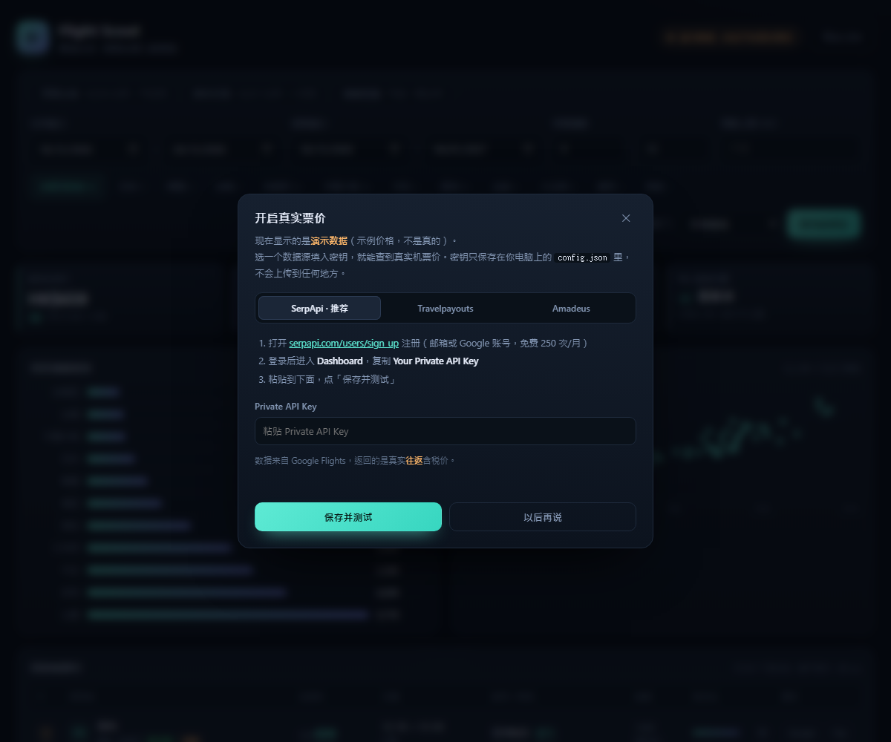

# 新手必读（3 步搞定）

完全不用敲命令、不用装东西。跟着做就行。

---

## 第 1 步：双击打开

在 `flight-scout` 文件夹里，双击：

```
启动.cmd
```

会弹出一个黑色窗口（别关它，关掉工具就停了），然后**浏览器会自动打开**。

如果浏览器没自动打开，手动在地址栏输入：

```
http://127.0.0.1:8777
```

> 窗口里出现一堆英文不用管，只要看到 `http://127.0.0.1:8777` 就说明成功了。

---

## 第 2 步：先随便玩玩

打开后你会看到一整屏的航班排行。这时的价格是**示例数据**——右上角有个**黄色小标签**写着「演示数据」。

你可以直接试这些（不会弄坏任何东西）：

- 点上面的 **圣诞主场 / 跨年长线 / 错峰捡漏** 三个按钮，看不同假期的结果
- 最左边的 **出发地** 可以换成深圳、广州、长沙、成都等（换完自动重查）
- 点区域按钮（日本、东南亚……）只看某个地区
- 点表格里每行右边的 **Google** 或 **Trip**，会跳到真实订票网站
- 右上角的 **🌙 / ☀️** 可以切换深色/浅色，默认浅色

---

## 第 3 步：换成真实价格（重点）

> 先看一眼右上角：如果已经是**绿色「实时」**，说明密钥配好了，这一步可以跳过。

**点右上角那个黄色标签**，会弹出一个设置框（长这样）：



保持选中「**SerpApi · 推荐**」这一栏，然后：

1. 点框里的蓝色链接 `serpapi.com/users/sign_up`（免费注册，邮箱或 Google 账号都行，英文网站）
2. 登录后进入 **Dashboard**，找到 **Your Private API Key** 那一串字符
3. 复制，粘贴到框里的输入框
4. 点「**保存并测试**」

成功的话，右上角标签会变成**绿色「实时」**，价格就是真的了。

> 免费额度是每月 250 次，一次搜索大约用 5 次，够用 50 次左右；同一组条件重复看不会重复扣。

---

## 想分享给同事？

**如果同事和你连的是同一个 Wi-Fi / 公司网络**：双击 **`共享给同事.cmd`**，
黑窗口里会多出一行「同事访问 http://192.168.x.x:8777」，把这行发给他们，他们用浏览器打开就能用，什么都不用装。

- 同事能查询、看结果、导出表格，但改不了密钥（只有你的电脑能改）
- 你的电脑得开着，关掉窗口就没了
- 第一次运行时 Windows 可能弹防火墙提示，勾「专用网络」允许即可

**如果同事不在同一个网络**（比如在家、在外地），那就需要放到一台公网服务器上，
这步比较折腾，需要的话告诉我，我帮你选方案。

---

## 常见问题

**Q：黑色窗口能关吗？**
不能。它就是工具本身，关掉网页就打不开了。不用的时候关掉即可，下次再双击 `启动.cmd`。

**Q：双击没反应 / 一闪而过？**
说明找不到 Python。工具需要电脑里有 Python 3.10 以上版本。装好后重新双击即可。
（如果这台电脑装过，通常已经能用了。）

**Q：Amadeus 那个注册页面打不开了？**
对，**Amadeus 的免费自助版在 2026 年 7 月 17 日已经关停**，现在只给企业客户用。
用设置框里第一栏的 **SerpApi** 就行，比它更好用。

**Q：填了密钥但没变绿？**
设置框里会显示红色的错误原因。最常见的是复制时少了字符，重新复制一遍 key（注意前后不要带空格）。

**Q：安全吗？密钥会不会被上传？**
不会。密钥只写在你本机的 `flight-scout\config.json` 文件里，工具只跟 SerpApi 官方服务器通信。

**Q：价格准吗？**
价格实时变动，工具的作用是**帮你把 90 多个目的地一次排好序**，最终以航空公司或 Trip.com 结账页为准。

**Q：想换出发日期怎么办？**
页面上「出发窗口 / 返程窗口 / 停留晚数」直接改，点「查询最便宜」。
